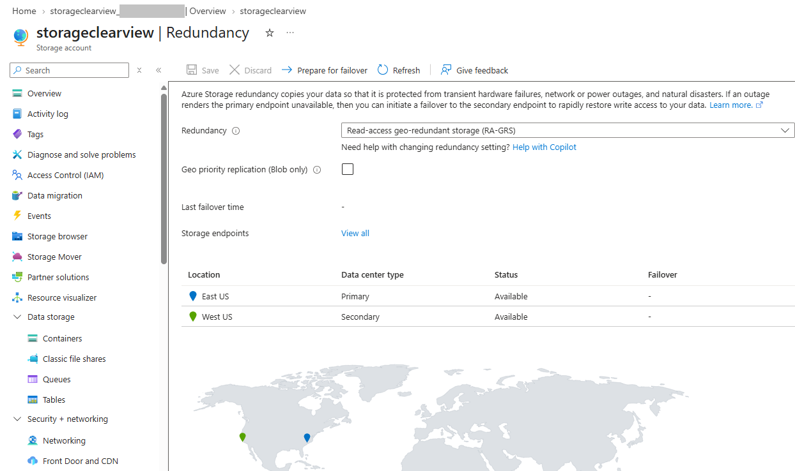
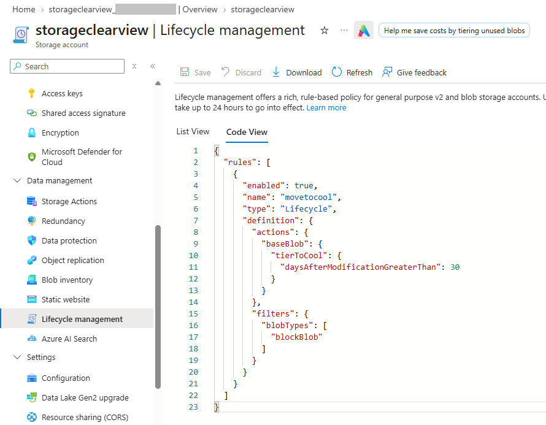
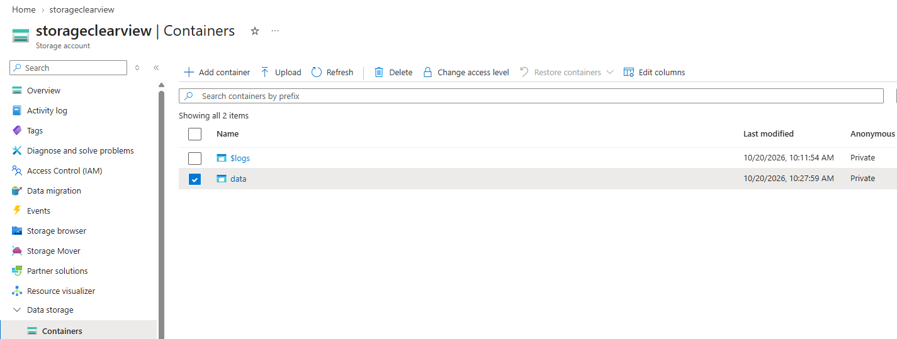

# Lab 02: Storage & Backup 🚧 In progress

> Part of the [AZ-104 Azure Administrator Journey](../README.md). ClearView Dental Associates and all names, accounts, and data are fictional. No real patient data was used. This lab is based on Microsoft's AZ-104 learning content and is not affiliated with Microsoft.

**Exam domain:** Implement and manage storage; Monitor and maintain Azure resources | **Outcome:** Secure, cost-aware storage and a tested backup and disaster recovery baseline for ClearView's data.

## Contents

1. [Business Scenario](#business-scenario)
2. [Cost & Safety Notes](#cost--safety-notes)
3. [Walkthrough](#walkthrough)
4. [Results, Challenges & What I Learned](#results-challenges--what-i-learned)
5. [Production Considerations](#production-considerations)
6. [Cleanup](#cleanup)

---

## Business Scenario

ClearView Dental Associates keeps imaging archives and patient documents on aging on-premises file servers. Most files are rarely opened after the first few weeks. Tremols Tech needs to move that data into Azure so that:

- rarely used files cost less to store
- access is private, authenticated, and time-limited
- files can't be deleted or altered during a retention period
- VM-based practice systems can be backed up and recovered after accidental or malicious data loss
- a regional outage doesn't take down critical systems

This lab builds on the [Lab 01](../01-identity-and-governance/) baseline: resources follow the same naming convention and carry the `CostCenter: 000` tag.

**What this lab covers**

- Storage accounts and redundancy (RA-GRS)
- Lifecycle management
- Blob containers, immutable storage, and SAS tokens
- Azure Files and Storage Browser
- Network restriction with service endpoints
- Recovery Services vaults and Azure Backup
- Azure Site Recovery (VM replication)

*Outcome: secure, cost-aware storage and a tested backup and recovery baseline.*

**Prerequisites**

| Requirement | Details |
|---|---|
| Azure subscription | Pay-As-You-Go |
| Azure role | Owner on the subscription |
| Tools | Azure Portal, with CLI equivalents for reference |
| Lab files | VM template and parameters from Microsoft's AZ-104 learn path |

**Resources used**

| Resource | Name | Region |
|---|---|---|
| Resource group (storage) | `rg-clearview-storage` | East US |
| Storage account | `storageclearview` | East US |
| Virtual network | `vnet-clearview-storage` | East US |
| Resource group (backup) | `rg-clearview-backup-eus` | East US |
| Recovery Services vault | `rsv-clearview-eus` | East US |
| Resource group (DR) | `rg-clearview-backup-wus` | West US |
| Recovery Services vault | `rsv-clearview-wus` | West US |

## Cost & Safety Notes

- A budget alert ($10) was set before deploying anything.
- The backup lab deploys a VM and Site Recovery replication, which are the main cost drivers. I plan to delete everything the same day.
- Screenshots are redacted of subscription IDs, emails, and my IP address. No screenshot shows a SAS URL or token, an access key, or the VM password.
- The Lab 01 tag policy only applies to `rg-clearview-governance`, so I tagged each new resource group manually.

## Walkthrough

All steps were performed in the **Azure Portal**. Screenshots are stored in `./images/`.

### Part 1: Storage Account, Redundancy & Lifecycle

**Why:** ClearView's archives are large and rarely accessed, so the right redundancy and tiering controls both cost and resilience.

**1. Created the resource group**
- Created `rg-clearview-storage` in East US with the tag `CostCenter: 000`.

**2. Created the storage account**

| Setting | Value |
|---|---|
| Performance | Standard |
| Preferred storage type | Azure Blob Storage or Azure Data Lake Storage |
| Region | East US |
| Redundancy | Geo-redundant storage with read access to the secondary region (RA-GRS) |
| Public network access | Disabled |
| Data protection / Encryption | Defaults (7-day soft delete) |



**3. Reviewed networking and redundancy**
- Confirmed public network access was disabled, then set it to **Enabled from selected networks** and added my client IPv4 address (redacted in screenshots).
- Reviewed the **Redundancy** blade for the primary and secondary regions.

**4. Created a lifecycle rule**
- Created a rule named `Movetocool` that moves base blobs to the cool tier when last modified more than 30 days ago.



<details>
<summary>CLI equivalent</summary>

```bash
az group create --name rg-clearview-storage --location eastus --tags CostCenter=000

az storage account create --name storageclearview --resource-group rg-clearview-storage \
  --location eastus --sku Standard_RAGRS --kind StorageV2 \
  --allow-blob-public-access false --public-network-access Disabled --tags CostCenter=000
```

Lifecycle policy (`policy.json`):

```json
{
  "rules": [
    {
      "enabled": true,
      "name": "Movetocool",
      "type": "Lifecycle",
      "definition": {
        "actions": { "baseBlob": { "tierToCool": { "daysAfterModificationGreaterThan": 30 } } },
        "filters": { "blobTypes": [ "blockBlob" ] }
      }
    }
  ]
}
```

```bash
az storage account management-policy create --account-name storageclearview \
  --resource-group rg-clearview-storage --policy @policy.json
```
</details>

### Part 2: Secure Blob Storage

**Why:** Imaging files must stay private, can't be deleted during a retention period, and need a safe way to share one file with an outside vendor.

**1. Created a private container**
- Created a container named `data` with the public access level left at **Private**.



> Opening the container's access policy returned a 403 ("This request is not authorized to perform this operation"). The storage firewall only allowed the IP I added earlier, and my VPN changed my source address. I confirmed my current IP, added it to the allowed list, waited a couple of minutes, and the page loaded. Lesson: storage firewall rules are based on the caller's source IP, so network changes can lock you out of your own account.


(Coming soon)
